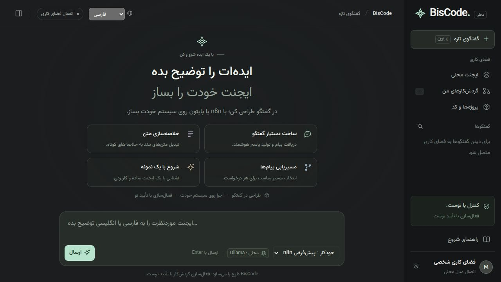

# BisCode

**Build n8n automations and Python agents with a local AI, through conversation.**

BisCode is a local agent builder with a bilingual English/Persian chat interface
and support for Persian conversations. It turns requests into reviewable n8n workflows, and can
create, edit, and test Python code with access you approve for each chat.

The primary workflow is **describe → build → inspect → deploy inactive → approve activation**.
Ollama runs the model on your machine; no paid model API key is required.



[Quick start](#quick-start) · [Connect n8n](#connect-n8n) ·
[Local coding](#local-coding) · [Configuration](#configuration) ·
[Development](#development) · [Architecture](docs/architecture.md)

## What you can build

- **n8n workflows:** Generate a typed intermediate representation, validate its
  structure and policy, and compile it into n8n JSON. Use the native node catalog
  for more advanced integrations and installed node types.
- **Python agents:** Create a standalone Ollama agent with a CLI, local HTTP
  endpoint, configuration, tests, and a downloadable project archive. Customize
  the starting template for the requested behavior.
- **Local code:** Inspect a selected folder, search source files, create and edit
  code, review diffs, run checks, and iterate on failures.
- **Telegram automation:** Configure a bot or personal account, review the
  workflow, and explicitly start a local message listener. The supplied bridge
  handles incoming text; scheduling, contact processing, and other behavior
  require a matching workflow or custom code.

The workspace includes persistent chat history, search, pinning, chat deletion,
workflow inspection, access approval, connection management, and execution logs.
Switch the interface between English and Persian from the top bar; the choice is
saved in this browser, with RTL layout for Persian. **The model's Persian
instructions and multilingual input support are preserved**. Persian messages retain their natural text direction.

## Documentation RAG

Python agent building retrieves official LangChain, LangGraph and LlamaIndex
references; n8n building retrieves n8n documentation. New Python agents start
with LangGraph. General local coding does not receive automatic RAG context.
Use **Getting started → Official documentation · RAG** to inspect and update the
local corpus, or run `uv run biscode docs sync`. Retrieval uses local SQLite
FTS5/BM25 without an additional embedding model or GPU allocation.

See [documentation retrieval](docs/knowledge.md) for scope, source dates, offline
operation, configuration, and limitations.

## Quick start

### Requirements

- Python **3.13 or 3.14** and [uv](https://docs.astral.sh/uv/).
- A running [Ollama](https://ollama.com/) instance with the configured model.
- Docker Engine and Compose **only when running n8n with the supplied Compose file**.
- Node.js 22+ only for JavaScript tests; the web interface has no Node.js runtime
  or frontend build requirement.

Run these commands from the repository root:

```bash
uv sync --frozen --group dev
uv run python scripts/bootstrap.py
uv run biscode docs sync
ollama pull qwen3.5:9b
mkdir -p work/projects
uv run biscode serve --workspace "$PWD/work/projects"
```

Skip the model download if that exact tag is already installed. If Ollama is not
running, start it using your installation's normal service or `ollama serve`.

Open **[http://127.0.0.1:8000](http://127.0.0.1:8000)**, select **Connect workspace**,
and enter `MASTER_API_KEY` from your private `.env` file. Bootstrap generates a
random key without printing it and preserves an existing `.env`.

Use `--port 8001` if you want a different port. Run **one application process and
one worker per database**. Do not start a second copy against the same SQLite file.

You can start planning workflows and working with Python before n8n is connected.
Deploying workflows requires the n8n configuration below.

## Your first workflow

Choose **n8n workflow** or leave the build method on **Auto**, then try:

> Build a Persian-speaking assistant that receives `body.message` through a POST
> webhook, answers with Ollama, and returns JSON.

Or write the request directly in Persian. Refine the same draft with follow-up
messages, inspect its nodes and JSON, and download the artifact for manual import.
Revisions create new builds rather than silently overwriting an existing workflow.

For a reproducible example from the command line, with BisCode running:

```bash
# Compile the supplied IR without calling the model or writing to n8n.
uv run python examples/build_client.py --ir examples/assistant.ir.json

# Generate a draft with the configured local model.
uv run python examples/build_client.py \
  --prompt 'Build a POST webhook assistant that reads body.message, answers with Ollama, and returns JSON.'
```

The client writes a build report and importable workflow JSON to `outputs/`.
A draft does not execute or activate anything in n8n.

## Connect n8n

The supplied Compose configuration targets a **local Linux host**. It uses host
networking so n8n can reach a native Ollama instance on loopback, and binds n8n to
`127.0.0.1:5678`. The default image is pinned in `compose.yaml`; override it with
`N8N_IMAGE` when deliberately upgrading.

```bash
docker compose config --quiet
docker compose up -d n8n
```

1. Open [http://localhost:5678](http://localhost:5678) and create the n8n owner account.
2. Create an n8n API key under **Settings → n8n API**.
3. Set `N8N_API_KEY` in `.env`, then restart BisCode.
4. Run `uv run biscode doctor` to check model availability and n8n authentication.

`OLLAMA_BASE_URL` is the address used by BisCode. `N8N_OLLAMA_BASE_URL` is the
address used by generated workflows running in n8n. These may differ when the
services run on different hosts or networks. Adapt networking for Docker Desktop
on macOS or Windows; the supplied host-network setup targets Linux.

Use **Deploy to n8n** to create an **inactive** workflow. Activation requires a
separate **Review & activate** action and approval of the exact reviewed version.
The API rechecks its content fingerprint and n8n version before activation.

An optional command-line review flow is also available:

```bash
uv run python examples/build_client.py --ir examples/assistant.ir.json --deploy
uv run python scripts/review_activation.py BUILD_ID
```

The second command requests a workflow-specific confirmation phrase. It does not
activate a workflow if the confirmation is missing or incorrect.

## Local coding

Open **Project folder & access** above the message box to choose a project and
apply file access or **Full access · current OS user** directly in the chat.
The execution timeline shows actual tool runs, file paths, and terminal results.

Choose **Python agent** for a new AI agent, or **Local coding** for scripts,
libraries, and changes to an existing project. n8n remains the default for agent
requests in Auto mode; explicit Python and coding requests can use the coding path.

> Create a Python agent that summarizes Persian text with Ollama. Write the files
> and tests, run the checks, and keep the service stopped.

Before using local files, BisCode opens an access request:

1. Select **Browse** to open the system folder chooser. You can also navigate folders
   and create a **New folder** in the in-app chooser, then select **Use this folder**.
   The project can live anywhere your OS user can access, including outside BisCode.
2. Review the scope: workspace files, or files and system commands.
3. Confirm and select **Approve & continue** to resume the saved request.

Access is scoped to the chat and expires after four hours by default. Running
commands and tests requires system access and uses your current OS user privileges.
This is not an operating-system sandbox and does not grant root privileges.
Use **Stop** to cancel the current task, including its running subprocess.

Edits are guarded against the last observed or successfully written file version.
Outside changes cause a conflict rather than a silent overwrite. Python checks
record real subprocess output and test counts; a suite with zero tests is not
reported as passing. The generated AI agent starts as a stateless chat template;
requested integrations still need to be implemented and tested.

Open **Projects & code** to review managed changes and Python agent project files,
test results, and ZIP downloads. Creating files does not start a persistent service.

See [the local coding contract](docs/coding.md) for tools, version guards, permissions,
continuation, and execution boundaries.

## Connections and Telegram

Open **Local Agent** to manage access, integrations, bindings, and logs.

- Register Telegram bot tokens, personal account credentials, or HTTP API connections
  through the connection forms. Do not place credentials or login codes in chat.
- Personal accounts sign in with a phone number, login code, and, when required,
  a two-step verification password.
- After reviewing and activating a compatible workflow, save a Telegram binding
  and separately approve starting its listener. Personal accounts require explicit
  chat selection.
- The local bridge forwards incoming text to the workflow webhook and returns its
  response. This path does not require a public tunnel; BisCode must remain running.
- Uncertain delivery outcomes are recorded for review rather than automatically
  resent. Explicit retries acknowledge the risk of duplicate effects.

See [the local runtime guide](docs/local-agent.md) for connector setup, node catalog
imports, plugins, and delivery recovery.

## Configuration

Bootstrap copies `.env.example`. The main settings are:

| Setting | Purpose | Default |
| --- | --- | --- |
| `MASTER_API_KEY` | Owner authentication for the control API | Generated by bootstrap |
| `OLLAMA_BASE_URL` | Ollama endpoint reachable by BisCode | `http://127.0.0.1:11434` |
| `OLLAMA_MODEL` | Exact installed Ollama model tag | `qwen3.5:9b` |
| `OLLAMA_NUM_CTX` | Model context budget | `16384` |
| `OLLAMA_NUM_PREDICT` | Maximum generated tokens per model response | `6000` |
| `N8N_BASE_URL` | n8n endpoint reachable by BisCode | `http://127.0.0.1:5678` |
| `N8N_API_KEY` | n8n API authentication | Empty until configured |
| `N8N_OLLAMA_BASE_URL` | Ollama endpoint reachable by n8n workflows | `http://127.0.0.1:11434` |
| `DATABASE_PATH` | SQLite database for chats, builds, and runtime state | `data/master-agent.sqlite3` |
| `LOCAL_WORKSPACE` | Default folder offered for local access | Current working directory |
| `LOCAL_VAULT_KEY` | Credential encryption key file | `vault.key` beside the database |
| `LOCAL_MAX_STEPS` | Maximum tool steps for n8n conversations | `10` |
| `CODING_MAX_STEPS` | Maximum tool steps for coding conversations | `20` |
| `HTTP_ALLOWED_HOSTS` | Allowed external hosts in the small IR | `[]` |

Restart the application after changing `.env`. Keep the model tag identical to an
entry in `ollama list`. Ollama remains the model backend; changing the UI language
does not download, replace, or change the model's weights.

## Architecture

The backend is **Python + FastAPI + LangGraph**, with SQLite persistence and a
bundled HTML/CSS/JavaScript interface.

- **Planning:** The model produces structured decisions or a typed workflow IR.
  The LangGraph planner validates and repairs the small IR within a bounded budget.
- **Compilation:** Pure, deterministic compilation converts validated IR or
  catalog-backed NativeSpec into n8n JSON.
- **Execution:** A tool registry enforces chat permissions, validates tool inputs,
  and returns bounded, redacted observations to the model.
- **Lifecycle:** Deployment, reconciliation, review, and activation are separate
  operations with persisted state and explicit owner approval.

The small IR supports manual, webhook, and minute-schedule triggers; scalar fields;
string conditions; allowlisted HTTPS requests; Ollama calls; and webhook responses.
NativeSpec extends this with registered n8n nodes, credentials, and richer graphs.
Structural validity does not establish that a workflow satisfies every requirement
or will execute successfully against a particular n8n installation.

See [architecture and API contracts](docs/architecture.md) for detailed schemas,
lifecycle transitions, concurrency, and activation safeguards.

## Development

```bash
make test       # Python regression tests; integrations use mocked transports
make test-ui    # JavaScript tests, including Persian UTF-8 handling
make check      # Python lint and formatting checks
uv build        # Build the source distribution and wheel
```

Optional checks against your installed Ollama model:

```bash
make smoke          # Model → validated IR → compiled JSON
make smoke-local    # Local tools and Telegram drafts with test connections
make smoke-coding   # Create, edit, and test a Python agent in a temporary folder
```

These checks do not prove live n8n or Telegram delivery. Review and test those
integrations separately in your configured environment.

## Troubleshooting

- **No response after a coding request:** Check the access request. Choose a folder,
  approve the scope, and select **Approve & continue**. The original prompt is saved.
- **Model unavailable:** Check `ollama list`, the exact model tag, and the Ollama URL.
- **Slow coding tasks:** A task can involve many model calls, file edits, and tests.
  Generation speed alone does not describe total completion time. Check actual tool
  activity, context size, and GPU offloading before choosing a larger model.
- **n8n is not configured:** Set `N8N_API_KEY`, restart BisCode, and run `biscode doctor`.
- **409 during activation:** The workflow or its version changed. Review it again.
- **Uncertain deployment or activation:** Reconcile the existing state before retrying.
  A lost response does not prove that the remote operation failed.

## Data and operating boundaries

BisCode is designed for a single owner on loopback. API control requires the owner
key. Integration credentials and code-change snapshots are encrypted; chat messages
and other SQLite metadata are stored locally without application-level encryption.
Back up both the database and its vault key. Losing the key prevents decryption of
existing encrypted records.

Workspace access limits managed file tools to the approved folder. System access
allows arbitrary commands as the OS user and is not confined by that file boundary.
Run the Python application on the host for host access; a Docker deployment has
access only to its container environment and mounted volumes.

`.env`, databases, vault keys, sessions, generated outputs, and `work/` are excluded
from Git. Review generated code and workflows before running or activating them.
The internal Python package remains `master_agent`, and `master-local` is retained
as a compatible CLI alias.

## Documentation

- [Chat workspace](docs/chat-ui.md)
- [Local coding and permissions](docs/coding.md)
- [Local Agent, connectors, and plugins](docs/local-agent.md)
- [Architecture and API contracts](docs/architecture.md)
- [Example workflows](examples/)

## License

[MIT](LICENSE). The bundled Vazirmatn font is distributed under its own
[Open Font License](src/master_agent/web/fonts/OFL.txt).
